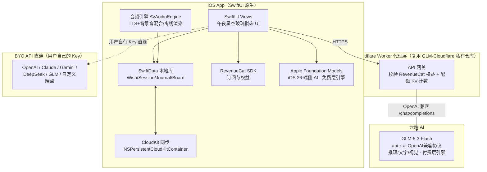
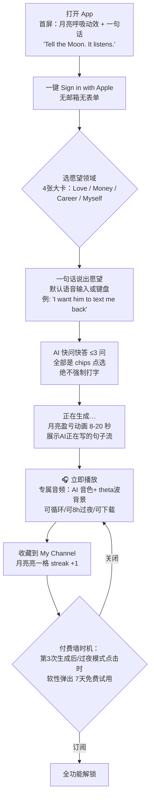
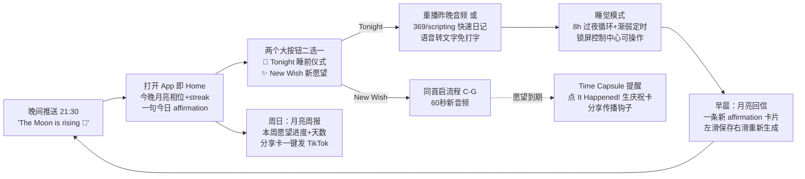
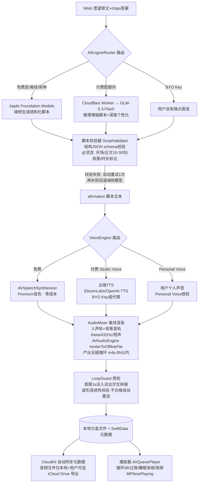
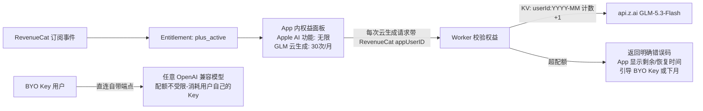

# TR-20261013-Moonwish（月光许愿）AI显化音频 App 操作指南

> **本文档目标**：任何 LLM / 开发者阅读本文档后，可从零复刻出一款在功能、UI、体验、价格上全面碾压竞品 **Vix（AI Manifestation）** 的 iOS 原生应用。
> **文档日期**：2026-10-13 ｜ **目标市场**：美国 ｜ **技术栈**：SwiftUI + SwiftData + CloudKit + Apple Foundation Models + GLM-5.3-Flash + RevenueCat
> **竞品参照**：Vix（App ID 6747910148，Monday Labs Inc.，$30K/月，峰值$44K/月，16%试用转化率，25个TikTok矩阵账号驱动）

---

# 〇、APP 命名与副标题（病毒传播级命名深度分析）

## 0.1 最终命名

| 项目 | 内容 | 说明 |
|---|---|---|
| **App 名称** | **Moonwish** | 主名，无冒号、无"主词：副词"结构，一个单词，朗朗上口 |
| **副标题（Subtitle ≤30字符）** | **Manifest While You Sleep** | 24字符，直接绑定 ASO 大词 "manifest" + 类目最强需求场景"睡眠显化" |
| **App 分类** | Health & Fitness（ Lifestyle 备选） | 与 Vix 同类目，抢其流量 |
| **推广社区名** | Moonwishers | 用户自称，TikTok 传播标签 #Moonwishers #ManifestWhileYouSleep |

## 0.2 命名分析（五维度）

1. **品牌记忆度（最关键）★★★★★**
   - `Moon + wish` 两个都是美国 18-35 岁女性高频情感词；合成词发音 2 秒节拍（Moon-wish），符合"听一次就记住"的音韵规则（辅音开头+收尾短促）。
   - 月亮本身就是显化文化的核心符号（new moon intention / full moon release 是 TikTok 千亿播放级仪式）。Vix 自己都在用"月亮主题 streak"，我们直接把文化符号放进品牌名里。
   - 自带画面感：闭上眼睛、对月亮许愿——这个名字本身就是产品使用场景的 3 秒广告片。

2. **ASO 搜索优化 ★★★★☆**
   - 名称内含 "wish"（显化/许愿类目核心搜索词），副标题含 "manifest" 与 "sleep" 两个高流量高意图关键词（Vix 的副标题没有 sleep，而"睡眠显化/pillow method"恰恰是 TikTok 上需求最硬的场景）。
   - "moon" 关键词族群（moon phase / moon ritual / moon journal）在 App Store 有稳定自然流量（MoonWise、Moon Child 等竞品验证了该词群的可发现性），Moonwish 可吃这波流量且与它们类目错位（我们是 AI 音频，不是占星工具）。

3. **功能描述性 ★★★★☆**
   - 名字直译即产品：在月亮（夜晚/睡前）下许愿（显化意图）——用户看到名字+副标题的组合，0 秒理解产品是干什么的。

4. **情感共鸣 ★★★★★**
   - "对月亮许愿"是全人类共同的童年情感原型（wish upon the moon/star），自带温柔、希望、私密感——正中显化人群"安全树洞"的心理需求。
   - 情感钩子文案直接可复用："Tell the Moon. It listens all night."（告诉月亮，它听一整晚）——天然 TikTok 视频口播素材。

5. **国际化适配 ★★★★☆**
   - Moon / Wish 是全球英语区儿童绘本级词汇，无俚语歧义、无宗教排他、无负面含义；西语区（luna + deseo）、日语区（月 + 願い）翻译后意象完全保留，未来出海零改名成本。

6. **占用性核验（2026-10-13 已查）**
   - App Store 无名为 "Moonwish" 的 App（仅有 MoonWise / Moonwax / Moonwake 等近拼名，无冲突）；Apple Books 有一本同名小说（不影响 App Store 商标类目）。
   - 已排除的候选名：Wishly（已占用）、Wishwave（已占用）、Wishora（Wishora Tap 已占用）、Vix（竞品原名，禁用）。
   - **备选名**：Wishling（App Store 未占用，社区名 Wishlings）。
   - ⚠️ 上架前动作：USPTO 商标检索 "Moonwish" 第 9/42 类 + Apple App Name 预占（创建 App Store Connect 记录即锁名）。

---

# 一、竞品 Vix 深度拆解与痛点清单

## 1.1 Vix 是什么（复刻基线）

- **玩法**：输入愿望 → AI 追问关键问题 → 生成个性化显化引导音频（affirmation session）；支持 subliminals（200+ 歌单/5000+ 条）、冥想、过夜音频、journaling（369法/scripting）、每日塔罗、21种仪式、SOS按钮、月亮主题 streak、10+ 音色、theta波/双耳节拍/432Hz/lo-fi 背景音、13语言、Spotify/YouTube 音频分发。
- **收入**：净订阅收入 $140K+/年，峰值月 $44K；免费基础 session + Premium 约 **$19.99/月、$39.99/年**；无长期免费试用。
- **增长引擎**：25 个 TikTok 矩阵账号 + Spotify/YouTube 播客矩阵（占收入约 20%）。
- **技术栈**：Claude 内容管线 + Superwall 付费墙 + Railway 后端，4 周上线——证明此类产品技术门槛不高，胜负在**分发 + 体验 + 信任**。

## 1.2 痛点清单（按严重度排序，附用户原话）

| # | 痛点 | 用户原话（App Store/类目评论） | Moonwish 的解法（做到碾压） |
|---|---|---|---|
| P1 | **开场即付费墙、无免费试用** | "they were requiring a subscription upfront... there was no free trial to see what I was getting into" | 免费层真实可用：**每周 3 次完整 AI 个性化音频**（Apple 端侧 AI 生成，我们零成本）+ 20+ 条精品预设音频库；Plus 附 **7 天免费试用** |
| P2 | **音频太短、过夜播放坏** | "You're lucky for them to last two minutes... the loop does not work" | **8 小时无缝过夜音频**：生成时离线渲染成无缝循环 m4a，先本地压测 100% 循环无爆音才交付；支持下载离线听 |
| P3 | **数据丢失、无云备份（类目第一大差评）** | "Journal entries disappear. Streaks reset without explanation." | **SwiftData + CloudKit 全量自动云备份**（零配置，登录 Apple ID 即生效）+ 一键导出（音频/日记/愿景板打包）；本地优先，断网照常记录 |
| P4 | **streak 清零导致弃用** | "My streak randomly resets to zero. I know I did not miss a day." | **原谅型月亮 streak**：每月 1 个"云遮月"宽恕日，补卡不清零；streak 状态全部存 iCloud，永不因重装/更新丢失 |
| P5 | **客服失联、功能藏太深** | "I've been reaching out to support for well over a week and I haven't gotten a response" | 应用内新手引导一次性讲透 + 每个功能页首用气泡提示 + 应用内工单（48h 承诺回复）+ FAQ 自助 |
| P6 | **年费无月付选项、扣费不透明** | （类目通病：$90/年无月付，试用转扣费投诉多） | **明码三档定价**（见第六章）+ 订阅管理一键直达系统页 + 续费前 48h 本地推送提醒 |
| P7 | **无显化结果闭环（仪式感缺失）** | （Reddit 诉求：想回看"愿望实现了没有"） | **Time Capsule 时间胶囊**：愿望设定期→实现日点击 "It Happened!"→生成庆祝卡（愿望原文+许愿那天月亮）→ 一键分享 TikTok/IG（病毒传播钩子） |
| P8 | **音频无沉淀、不能下载** | （Vix 音频分发在外部平台但 App 内体验浅） | **My Channel 个人电台**：所有生成音频自动归档成个人频道，按愿望分组，离线下载、CarPlay/锁屏播放 |

## 1.3 类目竞品定价对比（2026-10）

| App | 价格 | 免费策略 | 备注 |
|---|---|---|---|
| Vix | $19.99/月、$39.99/年 | 免费基础 session，无试用 | 我们的直接对标 |
| Manifest (ai-manifest) | $3.99/周 或 $24.99/年 | 3天试用 | 周订阅激进 |
| The Manifest App | ~$90/年 | 7天工作簿 | 年费无月付=P6痛点来源 |
| Fate – Subliminals | $4.99/周、$47.99/年 | 限时试用 | 纯 subliminal |
| You Are | $29.99/年 | 免费基础 | 低价锚 |
| DreamBoard | $27 买断 | — | 买断制存在需求 |
| **Moonwish（我们）** | **$7.99/月、$29.99/年** | **每周3次AI生成+20+音频库+7天Plus试用** | 年费价格锚定在 Vix 之下，免费层碾压所有人 |

---

# 二、产品定位与"爽文式"体验设计

## 2.1 一句话定位

> **Moonwish = 睡前 60 秒说出愿望，AI 把它变成一整晚陪你入睡的专属显化电台。**

核心情绪价值链：**说出（被倾听）→ 被追问（被认真对待）→ 听见自己的专属音频（被珍视）→ 早晨醒来有月亮回信（被回应）→ 愿望实现日有庆祝（被祝福）**。这就是"爽文"节奏：每一章都有即时反馈，每一次打开都有情绪增量。

## 2.2 竞品碾压矩阵

| 能力 | Vix | Moonwish | 碾压点 |
|---|---|---|---|
| 免费层 | 基础 session（限制多） | 每周3次**完整**AI个性化音频（端侧AI零成本供给）+ 20+精品音频 | P1 |
| AI 引擎 | 单一云端 LLM | **Apple 端侧 AI（免费层）+ GLM-5.3-Flash（付费层，推理+视觉）** 双引擎 | 快、免费、离线可用 |
| 音色 | 10+ 预置 | 8 预置 + **Personal Voice（用户自己的声音读 affirmation）** | 情感核弹级差异 |
| 过夜音频 | 短音频+坏循环 | 8h 无缝循环 + 下载离线 + 睡眠定时渐弱 | P2 |
| 数据安全 | 无云备份 | CloudKit 自动云备 + 一键导出 + Face ID 锁 | P3 |
| streak | 易清零 | 原谅型月亮 streak（云遮月补卡） | P4 |
| 结果闭环 | 无 | Time Capsule 庆祝卡 + 分享海报 | P7（自传播） |
| 定价 | $19.99/月无试用 | $7.99/月、$29.99/年、7天试用、BYO API 无限用 | P6 |
| BYO API | 无 | 支持 GLM/OpenAI/Claude/Gemini/DeepSeek/自定义 | 开发者/极客口碑 |
| 视觉板 | 有 | 有 + **AI 看图写 affirmation（GLM 视觉）**：拍下你的愿景板照片自动生成对应音频 | 独家功能 |

---

# 三、实现流程图（系统架构）



**架构要点**：
1. **双引擎路由器**（App 内 `AIEngineRouter`）：免费用户/离线/简单任务 → Apple Foundation Models（端侧、免费、隐私）；付费用户配额内 → GLM-5.3-Flash（推理深、视觉强）；BYO 用户 → 直连其自有 Key（任何 OpenAI 兼容端点）。
2. **API Key 安全**：GLM Key 永不打包进 App。付费层调用经 Cloudflare Worker 代理（即 `https://github.com/asunnyboy861/GLM-Cloudflare` 私有仓库，gh 已认证可访问，前端现成模块可配套用，**根据 glm api config skill 相应标准来配置这部分即可**，无需过多研究）；Worker 用 Cloudflare KV 记录每用户月配额。
3. **零后端服务器**：用户数据全在 CloudKit，配额在 Worker KV，订阅在 RevenueCat——无自建数据库，无数据丢失风险（直接消灭 P3 痛点）。

---

# 四、用户使用流程图（极简"爽文"体验，极端重要）

## 4.1 首次使用：90 秒从下载到听见自己的专属显化音频



**极简设计规则（降低学习成本到 0）**：
1. **三步必达核心价值**：选领域 → 说愿望 → 听音频。任何新用户 90 秒内必须听到自己的第一条专属音频（激活北极星指标）。
2. **追问全部是点选 chips**（如 "When? Tonight / This week / No deadline"），杜绝填表感；只有用户主动点键盘才出现键盘。
3. **生成即惊喜**：生成过程不黑屏等待——逐句流式展示 AI 写的 affirmation 文字（像收到月亮的回信），文字先到、音频随后，等待感变成期待感。
4. **付费墙只出现在"体验过价值之后"**：前 3 次完整生成完全免费（端侧 AI 零成本），第 3 次结束后才软性展示试用——与 Vix"开场即墙"形成鲜明对比（P1 碾压点）。
5. **每个界面只有一个主按钮**，颜色统一"月光金"，杜绝选择焦虑。

## 4.2 日常使用：睡前 21 天仪式循环（留存引擎）



**爽点节拍器**（像爽文一样每一章都有反馈）：
- 每天打开：月亮相位随 streak 变满（视觉成长）；
- 每次生成：专属感（自己的名字/愿望/场景被写进音频）；
- 每周一：月亮周报（进度可见）；
- 愿望实现：庆祝卡（终极大爽点）+ 分享带来新用户（传播闭环）。

---

# 五、软件数据流图（核心：切实解决问题、不易出错）

## 5.1 音频生成主数据流（最关键链路）



**防错设计（不易出错的硬规则）**：
1. **每一步都有降级路径**：GLM 失败→重试→回退端侧 Apple AI；云端 TTS 失败→回退系统音色。用户永远能拿到音频，绝不出现"生成了但听不了"。
2. **结构化输出而非自由文本**：AI 必须按 JSON schema 返回（`guided generation` / `response_format: json_schema`），字段缺失即触发重试——杜绝"AI 输出格式混乱导致播放器崩溃"。
3. **音频在设备本地渲染**（离线混音成文件），不流式播放云端音频——断网、弱网、后台播放全都不受影响，且生成一次永久可听（消灭"音频消失"类差评）。
4. **LoopGuard 强制质检**：所有过夜音频先本地验证循环无缝再给用户，直接消灭 Vix 的 P2 差评。
5. **配额记账在云端 KV + 本地双写**：本地先放行（体验快），云端 KV 对账（防刷）；配额不足时清晰告知剩余量与恢复时间，绝无暗扣。

## 5.2 数据模型（SwiftData @Model）

```swift
@Model final class Wish {
    var id: UUID
    var text: String                 // 愿望原文
    var category: String             // love/money/career/myself
    var answers: [String]            // AI追问的chips答案
    var createdAt: Date
    var targetDate: Date?            // Time Capsule 到期日
    var status: WishStatus           // growing / fulfilled / released
    var fulfilledAt: Date?
    @Relationship(deleteRule: .cascade) var sessions: [AudioSession]
}

@Model final class AudioSession {
    var id: UUID
    var scriptJSON: String           // 校验过的结构化脚本
    var fileName: String             // 本地 m4a 文件名
    var voice: String                // voice id / "personal"
    var soundscape: String           // theta/432hz/rain/lofi/none
    var duration: TimeInterval
    var engineUsed: String           // appleFM / glm / byo
    var createdAt: Date
    var playCount: Int
    var wish: Wish?
}

@Model final class DailyRecord {      // streak 与日记共用
    var date: Date                   // 当天0点，唯一键
    var listened: Bool
    journaled: Bool
    var streakProtectedByGrace: Bool // 云遮月宽恕日
}
```

> 所有模型通过 `ModelContainer(for: ..., cloudKitDatabase: .automatic)` 全量同步 iCloud；音频大文件不进 CloudKit（只同步元数据），导出走用户显式操作——兼顾"永不丢数据"与 iCloud 空间礼貌。

## 5.3 权益与配额数据流



---

# 六、价格策略（极端重要，详细规划）

## 6.1 定价哲学

1. **免费层要真有用**——用 Apple 端侧 AI（我们零边际成本）喂饱免费用户，口碑带来自然量（Vix 的 16% 转化率证明了类目付费意愿，缺的是信任入口）。
2. **涉及 GLM 云 API 消耗的功能，绝不一次性买断**（GLM 是消耗品，买断=亏损）；Apple AI 相关功能，付款后不限次数使用（零成本让利）。
3. **明码标价 + 月付选项 + 7天试用 + 一键管理订阅**——把类目最大差评区（扣费投诉）变成我们的获客文案。
4. **BYO API 模式必须多模型**：GLM / OpenAI / Claude / Gemini / DeepSeek / 自定义端点任选，严禁写死单一模型（前端现成模块可配套，**根据 ios 生成 skill 的相应标准来配置 BYO API 这部分**）。

## 6.2 定价表（美国市场）

| 档位 | 价格 | 内容 | 成本逻辑 |
|---|---|---|---|
| **Free 永久免费** | $0 | 每周 3 次完整 AI 个性化音频（Apple 端侧引擎）；20+ 精品预设音频库；愿景板（9图）；369/scripting 日记；月亮 streak；系统音色；基础背景音 3 种；CloudKit 云备份 | 端侧推理零成本；CloudKit 免费额度内 |
| **Plus 月付** | **$7.99/月** | 全部 Free + **Apple AI 功能不限次数** + **GLM 云生成 30 次/月**（Studio Voice 高级音色/深度个性化/视觉板看图）+ 8h 过夜模式 + Personal Voice + 全部 21 种背景音/仪式 + 音频下载导出 + SOS 急救模式 + 月亮周报 | GLM-5.3-Flash 极低单价，30次/月成本 <$0.5/用户，毛利 90%+ |
| **Plus 年付**（主推） | **$29.99/年**（7天免费试用） | 同月付全部；折合 $2.5/月 | 锚点：Vix $39.99/年、The Manifest App $90/年——我们年费最低、免费层最强 |
| **BYO API 模式** | 免费（需 Plus 或在 Free 层解锁） | 用户填自己的 GLM/OpenAI/Claude/Gemini/DeepSeek/自定义 Key → 云生成不限次数，消耗用户自己的额度 | 我们零成本；极客传播点 |
| **Cloud 补充包**（可选内购） | $1.99 = 30 次 GLM 云生成（永久有效） | 月度 30 次用完的高频用户临时购买 | 消耗品内购，杜绝买断全功能 |

## 6.3 付费墙策略

- **时机**：第 3 次免费生成结束后 / 首次点击"过夜模式"时 / streak 第 7 天月亮变满月时——三个"价值峰值时刻"才展示，绝不开场弹墙。
- **展示**：价格页明列月/年两档 + 7天试用 + 底部"Manage Subscription"直达系统订阅页 + "Restore Purchase"；年付档标注"7 days free, then $29.99/year, cancel anytime"。
- **试用转化**：试用开始前本地推送提醒"Your Plus trial ends in 2 days"（消灭"莫名被扣费"投诉）。
- **禁止项**：❌ 一次性买断全功能（因 GLM 消耗）；❌ 周订阅（类目周订阅差评重灾区）；❌ 自动跳转扣费的暗黑模式。

---

# 七、核心技术实现代码示例与编写规则

## 7.1 双引擎路由器（Apple AI 优先，GLM 兜底/增强）

```swift
import FoundationModels   // iOS 26 Apple Foundation Models

enum AIEngine: String { case appleFM, glm, byo }

actor AIEngineRouter {
    func generateScript(for wish: WishInput, tier: UserTier) async throws -> ManifestationScript {
        // 1) 免费层/离线 → 端侧 Apple AI（guided generation 保证结构）
        if tier == .free || !NetworkMonitor.shared.isOnline {
            return try await self.appleFMGenerate(wish)
        }
        // 2) 付费层 → GLM-5.3-Flash（经 Cloudflare Worker 代理，深度推理）
        do {
            return try await self.glmGenerate(wish, quota: tier.monthlyCloudQuota)
        } catch {
            return try await self.appleFMGenerate(wish)   // 降级保底，绝不让用户空手
        }
    }

    // Apple 端侧：结构化生成（@Generable schema，天然防格式错误）
    private func appleFMGenerate(_ w: WishInput) async throws -> ManifestationScript {
        let session = LanguageModelSession(instructions: ScriptPrompts.system)
        let script: ManifestationScript = try await session.respond(
            to: ScriptPrompts.userPrompt(w), generating: ManifestationScript.self
        ).content
        return script
    }

    // GLM-5.3-Flash：OpenAI 兼容协议，经自有 Worker 代理（Key 不落 App）
    private func glmGenerate(_ w: WishInput, quota: Int) async throws -> ManifestationScript {
        var req = URLRequest(url: AppConfig.glmProxyURL)  // https://your-worker.workers.dev/v1/chat/completions
        req.httpMethod = "POST"
        req.setValue("application/json", forHTTPHeaderField: "Content-Type")
        req.httpBody = try JSONEncoder().encode(GLMChatRequest(
            model: "glm-5.3-flash",
            messages: [.system(ScriptPrompts.system), .user(ScriptPrompts.userPrompt(w))],
            responseFormat: .jsonSchema(ManifestationScript.schema),
            stream: false
        ))
        let (data, _) = try await URLSession.shared.data(for: req)
        return try GLMResponse<ManifestationScript>.decode(data)
    }
}
```

> **GLM 配置说明**：代理部署与 Key 管理直接复用私有仓库 `https://github.com/asunnyboy861/GLM-Cloudflare`（gh 已认证可访问，含现成前端模块），**根据 glm api config skill 相应标准来配置这部分**即可。美国市场使用国际版端点 `https://api.z.ai/api/paas/v4/chat/completions`（美元计费；BigModel Key 可直接在 z.ai 端点使用，智谱已统一 Key 体系；接口文档见 `https://docs.bigmodel.cn`）。GLM-5.3-Flash 支持文字/推理/图片识别（用于"拍愿景板自动生成对应音频"独家功能）。

## 7.2 TTS + 背景音离线混音（无缝过夜循环的关键）

```swift
import AVFoundation

final class AudioMixer {
    /// 离线渲染：人声轨 + 背景音轨 → 无缝循环 m4a（本地文件，永久可听）
    func renderLoop(script: ManifestationScript,
                    voice: AVSpeechSynthesisVoice,
                    soundscape: Soundscape,
                    targetHours: Double = 8) async throws -> URL {
        let engine = AVAudioEngine()
        let speech = AVSpeechSynthesizer()          // 免费层：系统 Premium 音色
        let mixerOut = engine.mainMixerNode
        let format = mixerOut.outputFormat(forBus: 0)

        let outFile = try AVAudioFile(forWriting: tempURL,
                                      settings: [:],
                                      commonFormat: .pcmFormatFloat32,
                                      interleaved: true)
        // 背景音循环读取（theta波/432Hz/雨声，音量-18dB 不压人声）
        let bgPlayer = AVAudioPlayerNode()
        engine.attach(bgPlayer); engine.connect(bgPlayer, to: mixerOut, format: format)
        // 手动安装输出 tap 逐块写文件 …（略：官方 Sample Code "Rendering offline" 模式）
        // 人声：把 script.segments 逐句 schedule 到 speech，
        //   句间 1.2s 静音（呼吸感），首尾各 1s 淡入淡出
        // LoopGuard：渲染完成后自动校验首尾波形连续性，不达标自动重渲
        return finalURL   // 存沙盒 + SwiftData 记录元数据
    }
}
```

**编写规则**（必须遵守，防类目差评）：
1. 生成音频**必须落成本地文件**，禁止依赖云端流式播放（防断网/失效）。
2. 过夜音频必须过 **LoopGuard 质检**（首尾交叉淡化 + 波形校验）才允许进入播放器。
3. 音频会话配置：`.playback` + `mixWithOthers`（允许用户同时听播客类 App 时叠加环境音——Cat on Chair 的类目差评教训）；支持锁屏/控制中心 `MPNowPlayingInfoCenter`。
4. Personal Voice：`AVSpeechSynthesizer.personalVoiceAuthorization` 请求授权后可载入用户自建 Personal Voice——情感核弹级功能，默认引导开启。

## 7.3 SwiftData + CloudKit 自动云备份（消灭数据丢失）

```swift
let container = try ModelContainer(
    for: Wish.self, AudioSession.self, DailyRecord.self,
    configurations: ModelConfiguration(cloudKitDatabase: .automatic)
)
// 加 CloudKitSyncMonitor（MIT, ggruen/CloudKitSyncMonitor）在设置页显示
// "☁️ All changes synced to iCloud" 实时状态——把备份做成可见卖点
```

## 7.4 原谅型月亮 streak（消灭清零差评）

```swift
struct StreakEngine {
    /// 规则：当天 24 点前有任何一次"听音频或写日记"即 +1；
    /// 断签日自动消耗 1 个"云遮月"宽恕卡（每月免费 1 张，Plus 3 张）；
    /// 宽恕卡用尽才断；streak 数据在 CloudKit，重装不丢。
    func updateStreak(on date: Date, records: [DailyRecord], graces: inout Int) -> Int {
        let today = records.first { Calendar.startOfDay($0.date) == Calendar.startOfDay(date) }
        guard let today, today.listened || today.journaled else {
            if graces > 0 { graces -= 1; return lastStreak(records) }  // 云遮月兜底
            return 0
        }
        return lastStreak(records) + 1
    }
}
```

## 7.5 付费墙（RevenueCat）

```swift
import RevenueCat
Purchases.configure(withAPIKey: AppConfig.revenueCatKey)
// Entitlements: "plus"（月/年自动映射）；Offerings 配置月 $7.99 / 年 $29.99+7天试用
// Cloudflare Worker 校验：GET /entitlements/:appUserID → RevenueCat REST API 验真
```

## 7.6 可二次开发的开源项目参考（2026-10 实测核验）

| 模块 | 项目 | License | 复用点 |
|---|---|---|---|
| LLM 客户端 | MacPaw/OpenAI（2.9k★） | MIT | 自定义 baseURL 直连 GLM/BYO 多端点，自带流式 |
| SSE 流式 | Recouse/EventSource（161★） | MIT | 备选独立 SSE 实现 |
| 云同步监控 | ggruen/CloudKitSyncMonitor（584★） | MIT | 同步状态 UI |
| 付费墙 | RevenueCat/purchases-ios（3.1k★） | MIT | 订阅基建 |
| 愿景板布局 | exyte/Grid（2.1k★）+ exyte/MediaPicker（489★） | MIT | 瀑布流/多列布局+图片多选 |
| 端侧 TTS（二期） | k2-fsa/sherpa-onnx（15.2k★）或 mlalma/kokoro-ios（292★） | Apache-2.0/MIT | Kokoro 端侧离线 TTS，免费高质量（体积+100-300MB，二期再做） |
| Apple FM 参考 | apple/coreai-models（2.2k★）+ apple/foundation-models-utilities（520★）+ anthropics/ClaudeForFoundationModels（324★） | BSD-3/Apache-2.0 | 端侧模型用法 + 第三方 provider 仿写范例 |
| ❌ 避免 | meditohq/medito-app（1.3k★） | **AGPL-3.0** | 只可架构参考，代码禁复制（License 污染） |

> 自研项（约200行，不值得引依赖）：streak 打卡、AVQueuePlayer 播放列表、 forgiveness 宽恕卡逻辑。

---

# 八、UI 设计规范（符合美国市场主流审美）

## 8.1 设计语言："Midnight Serenity"（午夜宁静）

- **主题**：深空午夜蓝黑（#0B1026 → #1A1F3D 渐变）为底，**月光金（#F5D9A8）** 唯一主行动色，点缀月晕白（#EEF2FF）——区别于 Vix 的紫色系，更有高级睡眠氛围。
- **风格**：iOS 26 Liquid Glass 玻璃拟态卡片 + 实时月亮盈亏动态壁纸（SwiftUI TimelineView + Canvas 绘制真实月相，streak 越高月亮越圆——核心成长可视化）。
- **字体**：New York（衬线，仪式感标题）+ SF Pro（正文）——美国用户熟悉的双字体层级。
- **动效**：月亮呼吸动画（4-7-8 呼吸法节奏，本身就是助眠功能）；生成中月亮由亏转盈；It Happened 庆祝为月环烟花。
- **布局趋势对齐**：Spotify 式音频卡横滑（美国用户零学习成本）、Duolingo 式 streak 条、Apple Journal 式时间线。
- **无障碍**：全 Dynamic Type、VoiceOver、Reduce Motion 降级为静态月亮。
- **首屏三要素**：今晚月相 + streak + 一个金色主按钮（Tonight）——任何界面不超过一个主按钮。

## 8.2 页面结构（5 个 Tab 上限）

1. **Tonight**（默认）：月相/今日 affirmation/两大按钮（Tonight 仪式 / New Wish）
2. **My Channel**：个人电台（按愿望分组的音频库，可下载/循环/CarPlay）
3. **Board**：愿景板（exyte/Grid 拼贴 + 拍照 AI 生成对应音频）
4. **Journal**：369/scripting/感恩日记（语音转文字）+ 月亮周报
5. **Profile**：订阅/BYO API 设置/云同步状态/宽恕卡/导出

---

# 九、开发里程碑（MVP 3 周）

| 周 | 交付 |
|---|---|
| W1 | 项目骨架 + SwiftData/CloudKit + 首启流程（选域→说愿望→端侧 AI 生成→播放）+ LoopGuard |
| W2 | 音频混音/过夜循环/下载 + My Channel + streak + GLM Worker 接入（复用 GLM-Cloudflare 仓库）+ RevenueCat 付费墙 |
| W3 | 愿景板 + Journal + Time Capsule + Personal Voice + BYO API 设置页 + 打磨动效/无障碍 + TestFlight |

**上架自查清单**：App Name 预占 Moonwish → USPTO 检索 → 隐私政策/订阅条款页 → Health & Fitness 类目合规（定位"励志/正念内容工具"，不做医疗声明）→ Personal Voice 授权用途说明 → RevenueCat Offerings 价格配置 → 7 天试用文案合规（明示续费价）。

---

# 十、给用户的特别提示（GLM API 提供事项）

本软件付费层的核心碾压能力（深度个性化脚本推理、拍愿景板看图生成、Studio Voice 深度个性化）依赖 **GLM-5.3-Flash**（消耗型 API，严禁买断、仅付费用户经 Worker 配额调用）。

**⚠️ 请提供 GLM-5.3-Flash 的 API Key**，用于配置：
1. Cloudflare Worker 代理（复用私有仓库 `https://github.com/asunnyboy861/GLM-Cloudflare`，gh 已认证；按 glm api config skill 相应标准配置）；
2. 美国市场走国际版端点 `https://api.z.ai/api/paas/v4/chat/completions`（美元计费；Key 体系已与 BigModel 统一）；接口/SDK/错误码文档见 `https://docs.bigmodel.cn`。

如暂不提供，MVP 仍可上线（免费层全部功能靠 Apple 端侧 AI 即可运行），但"视觉板看图生成"与"深度推理个性化"两项碾压功能将暂缓。

---

*生成：TR-20261013 ｜ 依据：Vix 竞品调研（Starter Story/App Store 差评/类目横评）+ GitHub 开源选型核验（star/license 2026-10-13 实时）+ 命名 App Store 占用性核验*
